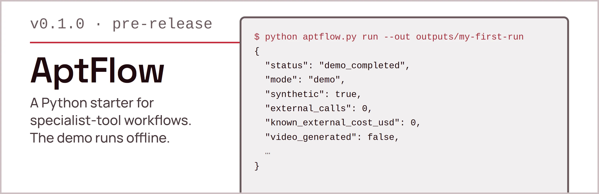

# AptFlow

An account-independent Python starter for developers who want to build workflows that assign each task to a specialist tool.

**Status:** v0.1.0 pre-release · MIT · the demo is synthetic and runs offline · the NotebookLM, TinyFish, model and HeyGen adapters are stubs, not implemented.

<picture>
  <source media="(prefers-color-scheme: dark)" srcset="docs/assets/aptflow-demo-dark.webp">
  
</picture>

*The report the last quickstart command prints is JSON. Shown shortened.*

[](https://github.com/Voyagerroc/AptFlow/actions/workflows/ci.yml)

## Quickstart

Requires Python 3.11+ and Git. Python's standard library is enough for the default demo. No cloud account, API key, FFmpeg or Docker is required for this quickstart.

```console
git clone https://github.com/Voyagerroc/AptFlow.git
cd AptFlow
python aptflow.py init
python aptflow.py doctor
python aptflow.py plan
python aptflow.py run --out outputs/my-first-run
```

Windows users can use `py -3.11`; some Unix systems use `python3` instead of `python`.

Expected result: the last command prints a JSON report that contains `"status": "demo_completed"`, `"synthetic": true`, `"external_calls": 0` and `"video_generated": false`; the image above shows that output, shortened. Inspect `outputs/my-first-run/storyboard.json` and `outputs/my-first-run/report.json`.

The last command writes `storyboard.json` and `report.json`. Every mock result is explicitly synthetic. Every run requires a fresh output directory and will not overwrite earlier work. The demo makes zero external calls.

`init` creates **your** ignored `aptflow.json`; it never overwrites an existing configuration. Change adapters and optional memory there. No personal notebook, account, source ID or machine path is included in the bundled demo.

More commands, exit codes, installation as `aptflow` and optional video rendering: [command reference](docs/CLI.md). Something went wrong: [troubleshooting](docs/TROUBLESHOOTING.md).

## Status

| Component | Status |
|---|---|
| Configuration, preflight and explicit workflow stages | Implemented |
| Account-free memory → research → script → storyboard demo | Implemented, synthetic data |
| Optional local FFmpeg rendering and media checks | Implemented |
| NotebookLM / TinyFish / model / HeyGen adapters | Extension stubs, not implemented |
| Activepieces workflow import | Not implemented; optional development container only |
| Canva / Descript | Future adapter ideas |

The mock video step produces a storyboard, not an avatar video. Selecting a provider or supplying credentials does not implement its adapter. No provider request is made by this starter.

## Architecture

```text
Your config → preflight → memory (optional) → research → script → video/storyboard
                                                           → validation → local artifacts
```

This starter uses explicit role mapping, not autonomous tool selection. `workflows/product-promo.json` is a design specification, not an importable Activepieces flow.

## Configure your own tools

Edit your ignored `aptflow.json` or copy `config/live.example.json` to a private config path. The example maps optional memory to NotebookLM, research to TinyFish, planning to your chosen reasoning model, and avatar video to HeyGen.

Default configuration:

```json
{
  "schema_version": 1,
  "mode": "demo",
  "tools": {
    "memory": {"adapter": "mock", "enabled": true},
    "research": {"adapter": "mock", "enabled": true},
    "script": {"adapter": "mock", "enabled": true},
    "video": {"adapter": "mock", "enabled": true}
  }
}
```

Only memory can be disabled with `enabled: false`. Research, script and video are required. In demo mode every enabled stage must use `mock`. Unknown fields/adapters are rejected.

```console
python aptflow.py doctor --config config/live.example.json
python aptflow.py plan --config config/live.example.json
```

The live example intentionally fails readiness because provider adapters are **stubs**. It reports variable names and implementation state without printing credential values. A run with incomplete adapters fails preflight before creating outputs or making provider requests.

`.env.example` lists blank placeholders. **The CLI does not load .env automatically.** Set variables in your own shell or deployment platform. Do not commit credentials; .env, user config, outputs and local history are ignored.

| Live boundary | Environment variable names | Status |
|---|---|---|
| TinyFish | `TINYFISH_API_KEY` | Unimplemented |
| Your reasoning model | `MODEL_API_KEY`, `MODEL_NAME`, `MODEL_BASE_URL` | Unimplemented |
| HeyGen | `HEYGEN_API_KEY`, `HEYGEN_AVATAR_ID`, `HEYGEN_VOICE_ID` | Unimplemented |
| NotebookLM | `NOTEBOOKLM_NOTEBOOK_ID` plus your own authentication implementation | Unimplemented, optional |

These are proposed configuration names, not working connections. Inject credentials into the process environment for your future adapter; never put real values in a README, issue, pull request or committed JSON file.

See the [adapter guide](docs/ADAPTERS.md). NotebookLM authentication is optional and user-managed; a notebook ID alone is not authentication. Do not copy someone else's sessions, private memories or credentials.

## Optional Activepieces backend

Docker is optional and unrelated to the CLI demo. `compose.yaml` is a single-instance local prototype based on the vendor's [hobbyist guide](https://www.activepieces.com/docs/install/options/docker).

```console
docker compose config --quiet
docker compose up -d
```

Open http://localhost:8095 and create your own account. This embedded setup has migration limitations and is not for production. The image defaults to latest for evaluation; pin a tested digest before a reproducible release. This Compose file has not been validated.

## Development

```console
python -m unittest discover -s tests -v
```

The [GitHub Actions workflow](.github/workflows/ci.yml) runs account-free unit tests and the synthetic demo on Ubuntu/Windows with Python 3.11 and 3.13. It uses read-only permissions, commit-pinned actions and no provider credentials. The demo report must identify synthetic output, zero external calls and no generated video. Optional media rendering is outside this job.

Check the workflow run for the exact reviewed commit before describing hosted checks as passing. A local test or workflow file alone does not establish a successful hosted run. The [portable template](templates/github-actions/ci.yml) contains the same job for forks. Dependabot monitors the GitHub Actions; no runtime Python dependencies are installed for these checks.

All examples are synthetic. No complete creative SaaS chain, automatic factual verification, cost savings or provider endorsement is claimed. The starter is MIT licensed; provider services and separately installed media tools have their own terms.

## Repository layout

```text
aptflow.py                 Direct CLI entry point
aptflow_core/
  cli.py                   init / doctor / plan / run / render
  config.py                Strict configuration validation
  adapters.py              Provider contracts, mock adapters, live stubs
  workflow.py              Stage execution and artifact report
  media.py                 Optional local video rendering
  demo-config.json         Account-free bundled config
config/live.example.json   Non-working live extension example
examples/                  Synthetic storyboard fixture
workflows/                 Future product-promo design specification
docs/                      Adapter guide, command reference, troubleshooting,
                           Turkish quickstart and the README images
tests/                     Offline tests
templates/github-actions/  Portable copy of the active CI workflow
compose.yaml               Optional Activepieces development container
.env.example               Empty credential reference, not auto-loaded
```

## Contribute

- Implement one opt-in research adapter and add offline response fixtures.
- Add a model adapter with structured output and measurable usage.
- Implement asynchronous video job persistence/reconciliation and media delivery.
- Add appropriate live cost and status accounting; do not reuse mock report fields.
- Evaluate a real Activepieces export only after the chosen connections work.
- Add dynamic routing only with explicit capability rules and evaluation cases.

These are future tasks, not capabilities delivered by this version. A useful contribution is one documented adapter, its contract and failure tests. See [CONTRIBUTING.md](CONTRIBUTING.md) and the [adapter guide](docs/ADAPTERS.md).

Türkçe: [adım adım çevrimdışı başlangıç ve sorun giderme](docs/QUICKSTART.tr.md).

---

Made by Erol Tasci at Voyagerroc Technologies · [voyagerroctechnologies.com](https://voyagerroctechnologies.com/en/)
